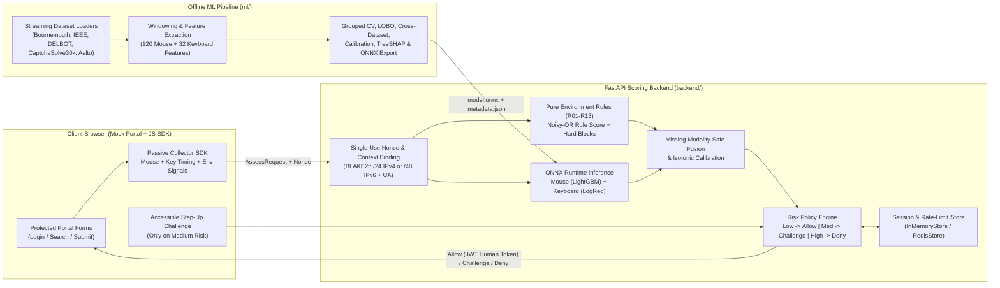

# Passive Bot Guard (SIH1672)

**Privacy-Preserving Passive Behavioural Bot Detection as an Alternative to CAPTCHA**

Passive Bot Guard is a modular machine-learning and web-security system developed for **Smart India Hackathon Problem Statement SIH1672**. It replaces intrusive visual/audio CAPTCHAs on web portals with **passive behavioural telemetry** (mouse trajectory kinematics, privacy-safe keystroke dynamics, and touch/scroll timing), a **deterministic browser-environment rule layer (`R01`–`R13`)**, and an **accessible step-up challenge** triggered only when risk is ambiguous.

> **Research & Scope Notice:** This project is an academic/student prototype designed strictly for a local mock portal. It is **not** a biometric identification system, surveillance tool, or production anti-fraud service. It never stores typed characters, key identities, form values, or persistent cross-site device fingerprints.

---

## Table of Contents

1. [System Architecture](#1-system-architecture)
2. [Repository Layout](#2-repository-layout)
3. [Privacy, Fairness & Security Principles](#3-privacy-fairness--security-principles)
4. [Datasets & Leakage-Free Data Pipeline](#4-datasets--leakage-free-data-pipeline)
5. [Machine Learning Models & Empirical Results](#5-machine-learning-models--empirical-results)
   - [5.1 Mouse Behaviour Model (LightGBM + ONNX)](#51-mouse-behaviour-model-lightgbm--onnx)
   - [5.2 Cross-Phase & Cross-Dataset Generalization](#52-cross-phase--cross-dataset-generalization)
   - [5.3 Leave-One-Bot-Type-Out (LOBO) Evaluation](#53-leave-one-bot-type-out-lobo-evaluation)
   - [5.4 CaptchaSolve30k Human-FPR Stress Test](#54-captchasolve30k-human-fpr-stress-test)
   - [5.5 Feature-Group Ablations, Calibration & ONNX Parity](#55-feature-group-ablations-calibration--onnx-parity)
   - [5.6 Keyboard Behaviour Model & Desktop Score Fusion](#56-keyboard-behaviour-model--desktop-score-fusion)
6. [Environment Rule Engine & Risk Policy](#6-environment-rule-engine--risk-policy)
7. [Quickstart & Developer Commands](#7-quickstart--developer-commands)
8. [Documentation & Artifact Index](#8-documentation--artifact-index)

---

## 1. System Architecture



The system is divided into five decoupled packages:

| Component | Directory | Responsibility |
| :--- | :--- | :--- |
| **Offline ML Pipeline** | [`ml/`](ml/) | Streaming dataset loaders, $O(N)$ sliding-window segmentation, 120-feature mouse & 32-feature keyboard extraction, leakage-safe grouped splits, Optuna hyperparameter tuning, isotonic/Platt calibration, TreeSHAP explanations, and ONNX export with numerical parity verification. |
| **Scoring Backend** | [`backend/`](backend/) | FastAPI service providing Pydantic v2 payload validation, single-use BLAKE2b nonces (`nonce.py`), pure environment rules `R01`–`R13` (`rules.py`), missing-modality-safe risk policy engine (`policy.py`), and `InMemoryStore` / `RedisStore` backends (`store.py`). |
| **Browser SDK** | [`sdk/`](sdk/) | Lightweight client collector capturing passive mouse kinematics, privacy-safe keystroke timing (`key_class` only), scroll/focus timing, and browser integrity signals. |
| **Mock Portal** | [`portal/`](portal/) | Local demonstration web application with protected workflows and accessible step-up verification. |
| **Bot Simulator** | [`bot-sim/`](bot-sim/) | Localhost-only automated bot traffic generator (strictly refuses non-local hosts) for testing detection tiers. |

---

## 2. Repository Layout

```text
MajorProject/
├── AGENTS.md                        # Operational rules & safety invariants for contributors/agents
├── PROGRESS.md                      # Phase-by-phase task completion tracker (Phases 0-10)
├── HANDOFF.md                       # Current session state and next-task handoff notes
├── config/
│   ├── datasets.example.yaml        # Template for read-only external dataset paths
│   └── rules.yaml                   # Configurable weights and enable flags for rules R01-R13
├── data/
│   ├── interim/                     # Canonical event-level Parquet shards (git-ignored)
│   └── processed/                   # Extracted window-level feature Parquet shards (git-ignored)
│       ├── mouse_features/          # 28,397 windows across 4,068 sessions (Bournemouth P1/P2, IEEE, DELBOT)
│       ├── mouse_stress_test/       # 662 windows across 300 CaptchaSolve30k human game sessions
│       └── keyboard_features/       # Privacy-safe Aalto human + K1-K4 synthetic bot windows
├── ml/                              # Python package: botguard-ml
│   ├── pyproject.toml
│   ├── scripts/
│   │   ├── train_mouse_efficient.py # End-to-end multi-dataset mouse training, evaluation & ONNX export
│   │   └── stage_a_train.py         # Single-dataset Bournemouth Stage-A baseline trainer
│   ├── src/botguard_ml/
│   │   ├── loaders/                 # Streaming loaders: web_bot_detection, ieee_blog_bots, delbot_mouse, captchasolve30k, aalto_keystrokes
│   │   ├── features/                # windowing.py, mouse.py (120 features), keyboard.py (32 features), keyboard_bots.py (K1-K4)
│   │   ├── splits.py                # Grouped, cross-phase, cross-dataset, and LOBO split utilities
│   │   ├── baselines.py             # Majority, Scaled Logistic Regression, Random Forest, LightGBM
│   │   ├── hparams.py               # Time-boxed Optuna search over 5-fold StratifiedGroupKFold
│   │   ├── aggregation.py           # Session-level window score aggregators (mean, top-k, max, logistic)
│   │   ├── calibration.py           # Grouped isotonic regression & Platt scaling calibration
│   │   ├── eval.py                  # Multi-split evaluation, group-bootstrap CIs, CaptchaSolve30k FPR
│   │   ├── ablations.py             # Feature-group and shortcut-feature ablation runner
│   │   ├── explanations.py          # TreeSHAP global summary & per-window top-3 feature contributors
│   │   ├── fusion.py                # Desktop mouse + keyboard pseudo-session score fusion
│   │   └── export_onnx.py           # LightGBM & sklearn ONNX exporters + runtime parity checks
│   └── tests/                       # 66 unit & property-based tests (pytest + Hypothesis)
├── backend/                         # Python package: botguard-backend
│   ├── pyproject.toml
│   ├── app/
│   │   ├── config.py                # Environment + YAML settings loader
│   │   ├── schemas.py               # Pydantic v2 request/response contracts & strict payload bounds
│   │   ├── rules.py                 # Pure environment rules R01-R13 & noisy-OR combiner
│   │   ├── nonce.py                 # Single-use cryptographic nonces bound to coarse IP + UA
│   │   ├── policy.py                # Risk fusion, missing-modality handling & allow/challenge/deny decisions
│   │   └── store.py                 # Thread-safe InMemoryStore and RedisStore implementations
│   ├── models/
│   │   ├── mouse-v1/                # Exported production mouse ONNX model + metadata.json
│   │   └── keyboard-v1/             # Exported production keyboard ONNX model + metadata.json
│   └── tests/                       # 277 unit & integration tests
├── results/
│   └── mouse/                       # Saved empirical CSV/JSON/Markdown benchmark reports
├── scripts/
│   ├── tasks.py                     # Unified cross-platform CLI runner (setup, lint, test, train-*, etc.)
│   └── status.py                    # Repository status and handoff summary script
└── docs/
    ├── model_card.md                # Comprehensive model card (Mouse, Keyboard, Desktop Fusion)
    ├── data_inventory.md            # Observed schemas and sizes of all public datasets
    ├── data_manifest.json           # SHA-256 hashes and licence notes for source datasets
    ├── privacy_register.md          # Signal privacy register and retention boundaries
    ├── decision_log.md              # Architectural and dataset decision log
    └── plan/                        # Phased implementation specifications (phase_0.md - phase_10.md)
```

---

## 3. Privacy, Fairness & Security Principles

1. **Zero Keystroke Content Logging**:
   - Keyboard loaders and SDK collectors strip all character identities at ingestion. Keys are mapped exclusively to coarse syntactic classes (`ALPHA`, `DIGIT`, `SPACE`, `BACKSPACE`, `ENTER`, `MODIFIER`, `PUNCT`, `OTHER`) plus press/release timestamps (`down_ms`, `up_ms`).
   - Automated privacy scanners ([`ml/src/botguard_ml/privacy/keyboard_scan.py`](ml/src/botguard_ml/privacy/keyboard_scan.py)) verify that no Parquet shard contains prohibited columns or raw text strings.
2. **Missing-Modality Fairness (Accessibility by Design)**:
   - A keyboard-only user (no mouse events) or a mouse-only user (no keyboard events) is **never** penalized for a missing modality.
   - [`backend/app/policy.py`](backend/app/policy.py) dynamically re-weights only the active modalities present in the session and requires a minimum observation threshold before scoring a behavioural channel.
3. **No Persistent Fingerprinting**:
   - Browser environment signals (`EnvSignals` in [`backend/app/schemas.py`](backend/app/schemas.py)) check only ephemeral automation indicators (`webdriver`, headless user-agent tokens, zero viewport dimensions, impossible hardware concurrency). Canvas, WebGL, AudioContext, and font-enumeration hashes are prohibited.
   - Nonce context binding ([`backend/app/nonce.py`](backend/app/nonce.py)) hashes only a truncated coarse network prefix (`/24` for IPv4, `/48` for IPv6) with `BLAKE2b` and expires within seconds.
4. **Strict Leakage Prevention**:
   - Every train/validation/test split in [`ml/src/botguard_ml/splits.py`](ml/src/botguard_ml/splits.py) groups by human participant/session (`split_group`) and by bot generator/run (`train_groups.isdisjoint(test_groups)` is enforced by assertion).

---

## 4. Datasets & Leakage-Free Data Pipeline

Raw datasets remain read-only outside the repository (configured via `config/datasets.local.yaml`) and are streamed in bounded chunks into canonical Parquet shards:

| Dataset | Modality | Role in Pipeline | Canonical Volume Extracted |
| :--- | :--- | :--- | :--- |
| **Bournemouth (`web_bot_detection`)** | Mouse + Env | Primary human & bot training/evaluation (`Phase 1` & `Phase 2`) | **449 sessions / 22,851 windows** (`P1`: 150 sessions, 7,574 windows; `P2`: 299 sessions, 15,277 windows) |
| **IEEE Blog Bots (`ieee_blog_bots`)** | Mouse | Cross-dataset & LOBO generalization (`human`, `fallible`, `humanish`, `mimic`) | **126 sessions / 1,114 windows** |
| **DELBOT-Mouse (`delbot_mouse`)** | Mouse | Multi-generator bot & human trajectories (`human`, `gan`, `naturalmousemotion`, `pyhm`, `pynput`) | **3,493 sessions / 4,432 windows** |
| **CaptchaSolve30k (`captchasolve30k`)** | Mouse | **Human-only FPR stress test** across 3 high-speed 240 Hz game tasks (`polygon-stacking`, `sheep-herding`, `thread-the-needle`) | **300 sessions / 662 windows** (held out from training) |
| **Aalto 136M Keystrokes (`aalto_keystrokes`)** | Keyboard | Human typing dynamics paired with synthetic bot generators `K1`–`K4` (`K3` held out) | Streamed per-participant shards |

### Key Data Engineering Safeguards
- **Chunk-Boundary Timestamp Repair**: Raw Bournemouth Phase 2 MongoDB exports contain 6,933 timestamp tokens truncated to 9 digits at chunk boundaries (which previously created `-50.9`-year timestamp gaps and caused naive windowing loops to hang for 9+ hours). [`parse_times`](ml/src/botguard_ml/loaders/web_bot_detection.py) repairs truncated millisecond prefixes against the session's median 13-digit epoch prefix before sorting.
- **$O(N)$ Two-Pointer Windowing**: [`window_events`](ml/src/botguard_ml/features/windowing.py) slices trajectories into 10-second windows with a 5-second hop using an $O(N)$ two-pointer sliding window that skips idle gaps in $O(1)$ time, deduplicates identical `(t_ms, x, y)` samples, and filters windows with fewer than 20 move events.

---

## 5. Machine Learning Models & Empirical Results

All metrics below are reproducible via [`ml/scripts/train_mouse_efficient.py`](ml/scripts/train_mouse_efficient.py) and saved under [`results/mouse/`](results/mouse/).

### 5.1 Mouse Behaviour Model (LightGBM + ONNX)

Trajectories within each 10-second window are segmented at pauses ($\ge 100\text{ ms}$) and click boundaries (requiring $\ge 8$ points and $\ge 20\text{ px}$ path length). Across segments, **120 features** are aggregated (`mean`, `std`, `min`, `max`, `iqr`, `p10`, `p50`, `p90`, `skew`):
- **Kinematics (54 features)**: Speed, acceleration, jerk, angular velocity, and path curvature.
- **Geometry (21 features)**: Path length, straightness ratio, net displacement, direction changes, bounding-box aspect/fill, and tail reversal.
- **Timing (38 features)**: Segment duration, sampling intervals (`dt_mean`, `dt_std`, `dt_cv`, `dt_mode_fraction`), pause ratios, peak-speed timing, and acceleration phase fraction.
- **Click Behaviour (9 features)**: Click dwell duration (`down` $\rightarrow$ `up`) and pre-click deceleration ratio.

#### In-Distribution Benchmark (814 Held-Out Test Groups / 5,252 Windows)
From [`results/mouse/baselines.csv`](results/mouse/baselines.csv) and [`results/mouse/evaluation_splits.csv`](results/mouse/evaluation_splits.csv):

| Model | Features | ROC-AUC (95% Group-Bootstrap CI) | PR-AUC | Recall @ 1% FPR | Recall @ 5% FPR | Balanced Acc | Brier Score |
| :--- | ---: | :--- | ---: | ---: | ---: | ---: | ---: |
| `majority` | 120 | `0.5000` | `0.6340` | — | — | `0.5000` | `0.3660` |
| `logistic_regression` (scaled) | 120 | `0.9902` | `0.9942` | — | — | `0.9554` | `0.0366` |
| `random_forest` | 120 | `0.9997` | `0.9998` | — | — | `0.9938` | `0.0091` |
| `lightgbm` (default) | 120 | `0.9997` | `0.9998` | — | — | `0.9932` | `0.0046` |
| **`lightgbm_tuned` (`all_features`)** | **120** | **`0.9999` `[0.9999, 1.0000]`** | **`1.0000`** | **`0.9994`** | **`1.0000`** | **`0.9956`** | **`0.0027`** |
| **`lightgbm_tuned` (`no_shortcuts`)** | **100** | **`0.9990` `[0.9982, 0.9996]`** | **`0.9991`** | **`0.9904`** | **`0.9991`** | **`0.9866`** | **`0.0093`** |

- **Optuna Hyperparameters** ([`results/mouse/hparams.json`](results/mouse/hparams.json), 5-fold `StratifiedGroupKFold` inner-CV ROC-AUC = `0.9998`): `n_estimators=203`, `learning_rate=0.1406`, `num_leaves=17`, `min_child_samples=27`, `subsample=0.8790`, `colsample_bytree=0.7921`.

---

### 5.2 Cross-Phase & Cross-Dataset Generalization

Because sampling rates and task durations vary across collection phases and datasets (`dataset_fingerprint_accuracy = 0.9985` in [`results/mouse/fingerprint.json`](results/mouse/fingerprint.json)), models that rely on **shortcut features** (`n_points`, `duration_ms`, `dt_mean`, `dt_mode_fraction`, `window_*`) overfit to collection-rate artifacts. Removing those 20 shortcut Columns (`no_shortcuts`, 100 behavioural features) dramatically improves cross-phase transfer ([`results/mouse/evaluation_splits.csv`](results/mouse/evaluation_splits.csv)):

| Evaluation Split | Feature Set | ROC-AUC (95% CI) | PR-AUC | Recall @ 1% FPR | Recall @ 5% FPR | Balanced Acc |
| :--- | :--- | :--- | ---: | ---: | ---: | ---: |
| **Cross-Phase `P1 -> P2`** | `all_features` (120) | `0.8297` `[0.7779, 0.8701]` | `0.7650` | `0.0066` | `0.1289` | `0.7426` |
| **Cross-Phase `P1 -> P2`** | **`no_shortcuts` (100)** | **`0.9785` `[0.9715, 0.9846]`** | **`0.9776`** | **`0.6100`** | **`0.8517`** | **`0.9238`** |
| **Cross-Phase `P2 -> P1`** | `all_features` (120) | `0.9746` `[0.9662, 0.9819]` | `0.9855` | `0.8497` | `0.9347` | `0.8272` |
| **Cross-Phase `P2 -> P1`** | **`no_shortcuts` (100)** | **`0.9970` `[0.9959, 0.9980]`** | **`0.9980`** | **`0.9690`** | **`0.9693`** | **`0.9774`** |
| **Cross-Dataset `Bournemouth + DELBOT -> IEEE`** | **`no_shortcuts` (100)** | **`0.9305` `[0.9006, 0.9551]`** | **`0.8977`** | **`0.2235`** | **`0.2235`** | **`0.6071`** |

---

### 5.3 Leave-One-Bot-Type-Out (LOBO) Evaluation

Each row in [`results/mouse/lobo_evaluation.csv`](results/mouse/lobo_evaluation.csv) trains the non-shortcut LightGBM model with **one entire bot generator completely excluded from training** and evaluates on the held-out bot windows plus held-out test human windows from the same dataset:

| Held-Out Bot Type | Dataset | Bot Windows ($N$) | Bot Sessions | ROC-AUC | PR-AUC | Recall @ 1% FPR | Recall @ 5% FPR |
| :--- | :--- | ---: | ---: | ---: | ---: | ---: | ---: |
| `mimic` | `ieee_blog_bots` | 252 | 35 | **`0.9950`** | `0.9964` | `0.9762` | `0.9802` |
| `fallible` | `ieee_blog_bots` | 302 | 35 | **`0.9947`** | `0.9972` | `0.9603` | `0.9735` |
| `humanish` | `ieee_blog_bots` | 59 | 12 | **`0.9927`** | `0.9858` | `0.8983` | `0.9492` |
| `advanced` | `web_bot_detection` | 8,303 | 170 | **`0.9710`** | `0.9935` | `0.2025` | `0.9026` |
| `pyhm` | `delbot_mouse` | 55 | 55 | **`0.9490`** | `0.8475` | `0.5818` | `0.6909` |
| `moderate` | `web_bot_detection` | 4,174 | 170 | **`0.9195`** | `0.9671` | `0.0630` | `0.3896` |
| `naturalmousemotion` | `delbot_mouse` | 877 | 234 | **`0.8365`** | `0.9397` | `0.0274` | `0.7640` |
| `pynput` | `delbot_mouse` | 531 | 351 | **`0.8202`** | `0.8753` | `0.3107` | `0.3107` |
| `gan` | `delbot_mouse` | 1,899 | 1,899 | `0.4872` | `0.8627` | `0.0026` | `0.0026` |

> **Key Finding:** Heuristic, spline-based, and human-mimicry bots (`mimic`, `fallible`, `humanish`, `advanced`, `pyhm`, `naturalmousemotion`) are detected zero-shot with **0.84–0.995 ROC-AUC**. However, `delbot_mouse:gan` (a GAN trained directly on DELBOT circle-task human trajectories) achieves `0.4872` ROC-AUC when no GAN trajectories are in the training set, underscoring why mouse kinematics must be fused with environment rules (`R01`–`R13`) and keyboard timing.

---

### 5.4 CaptchaSolve30k Human-FPR Stress Test

[`results/mouse/human_fpr_captchasolve30k.csv`](results/mouse/human_fpr_captchasolve30k.csv) evaluates false-positive rates on 662 human game windows from `CaptchaSolve30k` (recorded on a $200 \times 200$ canvas at a fixed 240 Hz physics tick where `dt_mode_fraction = 1.0`):

| Game Type | Windows ($N$) | FPR @ 5% Browsing-Human Threshold (All Features) | FPR @ 5% Browsing-Human Threshold (No Shortcuts) |
| :--- | ---: | ---: | ---: |
| `polygon-stacking` | 269 | `0.9591` | **`0.5725`** |
| `sheep-herding` | 270 | `0.7667` | **`0.3185`** |
| `thread-the-needle` | 123 | `0.9024` | **`0.3171`** |

---

### 5.5 Feature-Group Ablations, Calibration & ONNX Parity

- **Feature-Group Ablations** ([`results/mouse/ablations.csv`](results/mouse/ablations.csv), Scaled Logistic Regression reference):
  - `all_with_shortcuts` (120 features): **ROC-AUC `0.9902`**, PR-AUC `0.9942`
  - `all_without_shortcuts` (108 features): **ROC-AUC `0.9862`**, PR-AUC `0.9912`
  - `group_timing` (38 features): **ROC-AUC `0.9687`**, PR-AUC `0.9781`
  - `group_kinematics` (54 features): **ROC-AUC `0.9648`**, PR-AUC `0.9760`
  - `group_geometry` (21 features): **ROC-AUC `0.8890`**, PR-AUC `0.9277`
  - `group_click` (9 features): **ROC-AUC `0.5330`**, PR-AUC `0.6929`
- **Session Aggregation & Probability Calibration** ([`results/mouse/aggregation.csv`](results/mouse/aggregation.csv), [`results/mouse/calibration.json`](results/mouse/calibration.json)):
  - Aggregating window probabilities across a session via `mean` achieves a session-level test ROC-AUC of **`1.0000`** (`Brier = 0.0020`).
  - Isotonic regression calibration on held-out validation groups reduces test Brier loss from `0.0023` (uncalibrated) to **`0.0018`**.
- **ONNX Export & Numerical Parity** ([`backend/models/mouse-v1/model.onnx`](backend/models/mouse-v1/model.onnx)):
  - Exported via `onnxmltools` with median imputer statistics, feature order, and isotonic calibration curve bundled in [`backend/models/mouse-v1/metadata.json`](backend/models/mouse-v1/metadata.json).
  - Verified across 500 held-out test windows: **`max_abs_diff = 7.52e-08 < 1e-4`**.

---

### 5.6 Keyboard Behaviour Model & Desktop Score Fusion

- **Keyboard Model** ([`ml/src/botguard_ml/features/keyboard.py`](ml/src/botguard_ml/features/keyboard.py), [`ml/src/botguard_ml/keyboard_onnx.py`](ml/src/botguard_ml/keyboard_onnx.py)):
  - Extracts **32 text-agnostic timing features** from key-class windows: hold-time (`up_ms - down_ms`) and flight-time (`next_down_ms - up_ms`) quantiles, IQR, coefficient of variation, pause counts, burst lengths, lag-1 autocorrelation, backspace/correction ratio, and rollover fraction.
  - Trained against four synthetic bot generators (`K1` constant-interval, `K2` uniform-random, `K3` human-distribution mimic held out for evaluation only, and `K4` copy-paste burst bot) and exported to [`backend/models/keyboard-v1/model.onnx`](backend/models/keyboard-v1/model.onnx).
- **Desktop Score Fusion** ([`ml/src/botguard_ml/fusion.py`](ml/src/botguard_ml/fusion.py)):
  - Pairs calibrated mouse and keyboard probabilities in a deterministic same-class pseudo-session experiment, comparing `mouse_only`, `keyboard_only`, `mean`, `noisy_or`, and a validation-trained `logistic_stacker` while gracefully handling missing modalities.

---

## 6. Environment Rule Engine & Risk Policy

In addition to behavioural ML models, [`backend/app/rules.py`](backend/app/rules.py) evaluates **13 pure, deterministic environment integrity rules (`R01`–`R13`)** configured in [`config/rules.yaml`](config/rules.yaml):

- **`R01`–`R12` (Soft Automation Signals)**: Detect `navigator.webdriver === true`, headless browser tokens (`HeadlessChrome`, `PhantomJS`, `Playwright`, `Puppeteer`), missing language/plugin arrays, zero viewport/screen dimensions, inconsistent touch points vs mobile UA, and impossible event timestamps. Combined via a weighted **Noisy-OR** formula:
  $$S_{\text{rules}} = 1 - \prod_{i \in \text{fired}} (1 - w_i)$$
- **`R13` & Nonce Integrity (Hard Blocks)**: Missing/expired/replayed cryptographic nonces or tampered payload bounds bypass ML inference and immediately return a high-risk `deny` decision.
- **Three-Band Risk Policy** ([`backend/app/policy.py`](backend/app/policy.py)):
  - **Low Risk (`score < 0.35`)**: **`allow`** — Issues a short-lived signed JWT human token transparently; the user never sees a challenge.
  - **Medium Risk (`0.35 <= score < 0.75`)**: **`challenge`** — Triggers an accessible, keyboard- and screen-reader-friendly step-up verification.
  - **High Risk (`score >= 0.75` or hard rule fired)**: **`deny`** — Blocks the automated request.

---

## 7. Quickstart & Developer Commands

### Prerequisites
- **Python 3.11+** on Windows, macOS, or Linux.
- Virtual environments are isolated per package (`ml/.venv` and `backend/.venv`) and managed via [`scripts/tasks.py`](scripts/tasks.py).

### 1. Environment Setup, Linting & Tests

```powershell
# Create virtual environments and install ml + backend packages with dev dependencies
python scripts/tasks.py setup

# Run Ruff lint, formatting checks, and strict mypy type-checking
python scripts/tasks.py lint

# Run the full test suites (66 ML tests + 277 Backend tests)
python scripts/tasks.py test-fast

# View current repository progress and handoff status
python scripts/status.py
```

### 2. Mouse Model Training, Evaluation & ONNX Export

To run the complete multi-dataset mouse pipeline (feature shard verification, baselines, 5-fold grouped Optuna tuning, in-distribution/cross-phase/cross-dataset/LOBO/CaptchaSolve30k evaluations, isotonic calibration, ablations, TreeSHAP explanations, and ONNX parity verification):

```powershell
# Full pipeline (~3 minutes from scratch, or ~1.5 minutes reusing cached Optuna hyperparameters)
ml\.venv\Scripts\python.exe ml\scripts\train_mouse_efficient.py --reuse-hparams
```

Or run individual stages via the task runner:

```powershell
python scripts/tasks.py data-audit
python scripts/tasks.py fingerprint
python scripts/tasks.py train-mouse --stage features
python scripts/tasks.py train-mouse --stage baselines
python scripts/tasks.py train-mouse --stage hparams
python scripts/tasks.py train-mouse --stage ablations
python scripts/tasks.py train-mouse --stage shap
python scripts/tasks.py train-mouse --stage onnx
```

### 3. Keyboard Pipeline & Privacy Verification

```powershell
python scripts/tasks.py train-keyboard --stage events --max-participants 200
python scripts/tasks.py keyboard-privacy
python scripts/tasks.py train-keyboard --stage features
python scripts/tasks.py train-keyboard --stage evaluate
python scripts/tasks.py train-keyboard --stage onnx
```

---

## 8. Documentation & Artifact Index

| Document / Artifact | Description |
| :--- | :--- |
| [`docs/model_card.md`](docs/model_card.md) | Model card detailing Mouse, Keyboard, and Desktop Fusion models, empirical metrics, limitations, and ethical/privacy boundaries. |
| [`results/mouse/evaluation_splits.csv`](results/mouse/evaluation_splits.csv) | Full multi-split mouse benchmark (in-distribution, cross-phase `P1<->P2`, cross-dataset `Bournemouth+DELBOT->IEEE`) with 95% group-bootstrap CIs. |
| [`results/mouse/lobo_evaluation.csv`](results/mouse/lobo_evaluation.csv) | Leave-One-Bot-Type-Out evaluation across all 9 bot families. |
| [`results/mouse/human_fpr_captchasolve30k.csv`](results/mouse/human_fpr_captchasolve30k.csv) | Human false-positive stress test on `CaptchaSolve30k` across 3 game types. |
| [`results/mouse/failure_analysis.md`](results/mouse/failure_analysis.md) | Investigation of $>0.99$ in-distribution AUC, shortcut feature analysis, top-10 false positives, and top-10 hardest bot windows. |
| [`docs/data_inventory.md`](docs/data_inventory.md) | Detailed inventory of locally observed dataset schemas, file counts, and licence terms. |
| [`docs/data_manifest.json`](docs/data_manifest.json) | Cryptographic SHA-256 hashes and byte sizes of all raw dataset archives. |
| [`docs/privacy_register.md`](docs/privacy_register.md) | Signal-by-signal privacy classification, prohibited-data boundaries, and TTL retention rules. |
| [`docs/decision_log.md`](docs/decision_log.md) | Dated architectural and dataset decisions with evidence and scope. |
| [`docs/MASTER_PLAN.md`](docs/MASTER_PLAN.md) | Complete 10-phase system specification and acceptance criteria. |
