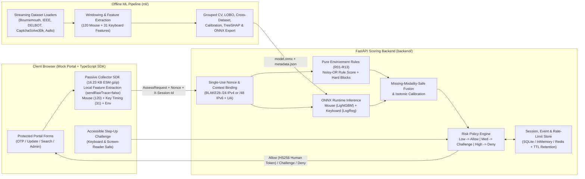

# Passive Bot Guard (SIH1672)

**Privacy-Preserving Passive Behavioural Bot Detection as an Alternative to CAPTCHA**

Passive Bot Guard is a modular machine-learning and web-security system developed for **Smart India Hackathon Problem Statement SIH1672**. It replaces intrusive visual/audio CAPTCHAs on web portals with **passive behavioural telemetry** (mouse trajectory kinematics and privacy-safe keystroke dynamics; mobile touch is intentionally disabled via `touch: null` in this release), a **deterministic browser-environment rule layer (`R01`–`R13`)**, and an **accessible step-up challenge** triggered only when risk is ambiguous.

> **Research & Scope Notice:** This project is an academic/student prototype designed strictly for a local mock portal. It is **not** a biometric identification system, surveillance tool, or production anti-fraud service. It never stores typed characters, key identities, form values, raw IP addresses, or persistent cross-site device fingerprints.

---

## Table of Contents

1. [System Architecture](#1-system-architecture)
2. [Repository Layout](#2-repository-layout)
3. [Privacy, Fairness & Security Principles](#3-privacy-fairness--security-principles)
4. [Datasets & Acquisition Instructions](#4-datasets--acquisition-instructions)
5. [Machine Learning Models & Empirical Results](#5-machine-learning-models--empirical-results)
   - [5.1 Mouse Behaviour Model (LightGBM + ONNX)](#51-mouse-behaviour-model-lightgbm--onnx)
   - [5.2 Cross-Phase & Cross-Dataset Generalization](#52-cross-phase--cross-dataset-generalization)
   - [5.3 Leave-One-Bot-Type-Out (LOBO) Evaluation](#53-leave-one-bot-type-out-lobo-evaluation)
   - [5.4 CaptchaSolve30k Human-FPR Stress Test](#54-captchasolve30k-human-fpr-stress-test)
   - [5.5 Feature-Group Ablations, Calibration & ONNX Parity](#55-feature-group-ablations-calibration--onnx-parity)
   - [5.6 Keyboard Behaviour Model & Desktop Score Fusion](#56-keyboard-behaviour-model--desktop-score-fusion)
   - [5.7 End-to-End System, Load & Security Benchmarks](#57-end-to-end-system-load--security-benchmarks)
6. [Environment Rule Engine & Risk Policy](#6-environment-rule-engine--risk-policy)
7. [Quickstart & Reproducing Results](#7-quickstart--reproducing-results)
8. [Limitations & Honesty Checklist](#8-limitations--honesty-checklist)
9. [Documentation Index, Licences & Citations](#9-documentation-index-licences--citations)

---

## 1. System Architecture



The system is divided into seven decoupled components:

| Component | Directory | Responsibility |
| :--- | :--- | :--- |
| **Offline ML Pipeline** | [`ml/`](ml/) | Streaming dataset loaders, $O(N)$ sliding-window segmentation, 120-feature mouse & 31-feature keyboard extraction, leakage-safe grouped splits, Optuna hyperparameter tuning, isotonic/Platt calibration, TreeSHAP explanations, and ONNX export with numerical parity verification. |
| **Scoring Backend** | [`backend/`](backend/) | FastAPI service providing Pydantic v2 payload validation, single-use BLAKE2b nonces (`nonce.py`), pure environment rules `R01`–`R13` (`rules.py`), ONNX scoring (`scoring.py`), missing-modality-safe risk policy engine (`policy.py`), mock portal API (`/portal-api/*`), admin telemetry endpoints (`/admin/*`), and TTL retention scheduler (`retention.py`). |
| **Browser SDK** | [`sdk/`](sdk/) | Zero-dependency TypeScript client collector (`16.23 KB` ESM / `14.87 KB` UMD gzip) capturing passive mouse kinematics, privacy-safe keystroke timing (`key_class` only), and browser integrity signals, with client-side feature extraction (`sendRawTrace=false`) and rotating ephemeral `X-Session-Id`. |
| **Mock Portal & Admin UI** | [`portal/`](portal/) | React/Vite local demonstration web application with protected citizen-portal workflows (`/portal-api/otp/request`, `/portal-api/details/update`, `/portal-api/centres/search`), accessible step-up verification, and an embedded Admin Dashboard (`AdminDashboardPage.tsx`). |
| **Bot Simulator** | [`simulator/`](simulator/) | Localhost-only automated bot traffic generator (strictly refuses non-local hosts) implementing Tiers 1–4 adversaries for end-to-end passive detection evaluation. |
| **Load Testing** | [`loadtest/`](loadtest/) | Locust-compatible and standalone async load-test harness (`scripts/run_loadtest.py`) measuring throughput, latency percentiles, and malicious block rates under mixed human/bot traffic. |
| **Evaluation & Reports** | [`scripts/`](scripts/) & [`results/`](results/) | Unified task runner (`scripts/tasks.py`), one-command evaluation aggregator (`scripts/eval_all.py`), rule-layer ablation (`scripts/rule_layer_ablation.py`), and publication-ready tables/figures in [`docs/report_assets/`](docs/report_assets/). |

---

## 2. Repository Layout

```text
MajorProject/
├── AGENTS.md                        # Operational rules & safety invariants for contributors/agents
├── PROGRESS.md                      # Phase-by-phase task completion tracker (Phases 0-10)
├── HANDOFF.md                       # Current session state and next-task handoff notes
├── config/
│   ├── datasets.example.yaml        # Template for read-only external dataset paths
│   └── rules.yaml                   # Configurable weights and enable flags for rules R01-R13
├── data/
│   ├── interim/                     # Canonical event-level Parquet shards (git-ignored)
│   └── processed/                   # Extracted window-level feature Parquet shards (git-ignored)
│       ├── mouse_features/          # 28,397 windows across 4,068 sessions (Bournemouth P1/P2, IEEE, DELBOT)
│       ├── mouse_stress_test/       # 662 windows across 300 CaptchaSolve30k human game sessions
│       └── keyboard_features/       # Privacy-safe Aalto human + K1-K4 synthetic bot windows
├── ml/                              # Python package: botguard-ml
│   ├── pyproject.toml
│   ├── scripts/                     # train_mouse_efficient.py, train_keyboard_efficient.py, stage_a_train.py
│   ├── src/botguard_ml/
│   │   ├── loaders/                 # Streaming loaders: web_bot_detection, ieee_blog_bots, delbot_mouse, captchasolve30k, aalto_keystrokes
│   │   ├── features/                # windowing.py, mouse.py (120 features), keyboard.py (31 features), keyboard_bots.py (K1-K4)
│   │   ├── splits.py                # Grouped, cross-phase, cross-dataset, and LOBO split utilities
│   │   ├── baselines.py             # Majority, Scaled Logistic Regression, Random Forest, LightGBM
│   │   ├── hparams.py               # Time-boxed Optuna search over 5-fold StratifiedGroupKFold
│   │   ├── aggregation.py           # Session-level window score aggregators (mean, top-k, max, logistic)
│   │   ├── calibration.py           # Grouped isotonic regression & Platt scaling calibration
│   │   ├── eval.py                  # Multi-split evaluation, group-bootstrap CIs, CaptchaSolve30k FPR
│   │   ├── ablations.py             # Feature-group and shortcut-feature ablation runner
│   │   ├── explanations.py          # TreeSHAP global summary & per-window top-3 feature contributors
│   │   ├── fusion.py                # Desktop mouse + keyboard pseudo-session score fusion
│   │   └── export_onnx.py           # LightGBM & sklearn ONNX exporters + runtime parity checks
│   └── tests/                       # Unit & property-based tests (pytest + Hypothesis)
├── backend/                         # Python package: botguard-backend
│   ├── pyproject.toml
│   ├── config/policy.yaml           # Risk thresholds, modality weights, fail-safe & retention config
│   ├── app/
│   │   ├── main.py                  # FastAPI application, /v1/*, /portal-api/*, /admin/* routers
│   │   ├── config.py                # Environment + YAML settings loader
│   │   ├── schemas.py               # Pydantic v2 request/response contracts & strict payload bounds
│   │   ├── rules.py                 # Pure environment rules R01-R13 & noisy-OR combiner
│   │   ├── nonce.py                 # Single-use cryptographic nonces bound to coarse IP + UA
│   │   ├── scoring.py               # ONNX inference for mouse-v1 & keyboard-v1 (raw or local features)
│   │   ├── policy.py                # Risk fusion, missing-modality fairness & allow/challenge/deny
│   │   ├── retention.py             # Automated 7d/30d TTL cleanup & daily-salted session_hash
│   │   ├── portal_api.py            # Protected mock portal endpoints (/portal-api/*)
│   │   ├── admin_api.py             # Admin monitoring, rules, threshold & feedback endpoints (/admin/*)
│   │   └── store.py                 # InMemoryStore, SQLiteStore, and RedisStore implementations
│   ├── models/
│   │   ├── mouse-v1/                # Exported production mouse ONNX model + metadata.json
│   │   ├── keyboard-v1/             # Exported production keyboard ONNX model + metadata.json
│   │   ├── keyboard-lgbm-v1/        # Tuned LightGBM keyboard ONNX model + metadata.json
│   │   └── fusion-v1/               # Desktop score-fusion metadata & coefficients
│   └── tests/                       # Unit, integration, security, retention & fairness tests
├── sdk/                             # TypeScript browser collector SDK (Vite library build + Vitest)
├── portal/                          # React + Vite mock citizen portal & Admin Dashboard + Playwright E2E
├── simulator/                       # Localhost-only Tiers 1-4 bot simulator
├── loadtest/                        # Mixed human/bot load-test suite
├── results/                         # Saved empirical CSV/JSON/Markdown benchmark reports
├── scripts/                         # tasks.py, status.py, eval_all.py, rule_layer_ablation.py, demo.py
└── docs/
    ├── model_card.md                # Final model card (Mouse, Keyboard, Desktop Fusion, System)
    ├── architecture.md              # End-to-end system architecture & data flows
    ├── api.md                       # Complete /v1/*, /portal-api/*, and /admin/* API reference
    ├── signals.md                   # Signal specification & client-side feature extraction
    ├── threat_model.md              # Adversary tiers, threat-to-mitigation matrix & residual risks
    ├── accessibility.md             # WCAG 2.1 AA audit, axe-core results & keyboard-only verification
    ├── privacy_register.md          # Signal privacy register and 7d/30d retention boundaries
    ├── data_inventory.md            # Observed schemas and sizes of all public datasets
    ├── data_manifest.json           # SHA-256 hashes and licence notes for source datasets
    ├── decision_log.md              # Architectural and dataset decision log
    └── report_assets/               # Publication-ready PNG figures & Markdown/CSV tables
```

---

## 3. Privacy, Fairness & Security Principles

1. **Zero Keystroke Content Logging**:
   - Keyboard loaders and SDK collectors strip all character identities at ingestion. Keys are mapped exclusively to coarse syntactic classes (`ALPHA`, `DIGIT`, `SPACE`, `BACKSPACE`, `ENTER`, `MODIFIER`, `PUNCT`, `OTHER`) plus press/release timestamps (`down_ms`, `up_ms`).
   - Automated privacy scanners ([`ml/src/botguard_ml/privacy/keyboard_scan.py`](ml/src/botguard_ml/privacy/keyboard_scan.py)) verify that no Parquet shard contains prohibited columns or raw text strings (`0` violations in [`results/keyboard/privacy_scan.json`](results/keyboard/privacy_scan.json)).
2. **Client-Side Feature Extraction (`sendRawTrace=false`)**:
   - The browser SDK supports computing the exact 120 mouse and 31 keyboard features locally in the browser and transmitting only summary feature vectors (`mouse_features`, `keyboard_features`) instead of raw event streams, achieving `< 1e-9` numerical parity with server-side extraction.
3. **Missing-Modality Fairness & Accessibility (WCAG 2.1 AA)**:
   - A keyboard-only user (no mouse events) or a mouse-only user (no keyboard events) is **never** penalized for a missing modality.
   - [`backend/app/policy.py`](backend/app/policy.py) dynamically re-weights only active modalities, caps keyboard-only human sessions with valid typing timing at `MISSING_MOUSE_VALID_KB_MAX_SCORE = 0.50` so they are never hard-denied, and pairs with an accessible step-up challenge verified at **`0` `axe-core` serious/critical violations across `11` UI states** ([`docs/accessibility.md`](docs/accessibility.md)).
4. **No Persistent Fingerprinting & Bounded Retention**:
   - Browser environment signals (`EnvSignals` in [`backend/app/schemas.py`](backend/app/schemas.py)) check only ephemeral automation indicators (`webdriver`, headless user-agent tokens, zero viewport dimensions, impossible hardware concurrency). Canvas, WebGL, AudioContext, and font-enumeration hashes are prohibited.
   - Nonce context binding ([`backend/app/nonce.py`](backend/app/nonce.py)) hashes only a truncated coarse network prefix (`/24` for IPv4, `/48` for IPv6) with `BLAKE2b` and expires within seconds.
   - Sessions use a rotating ephemeral `X-Session-Id` hashed with a daily rotating salt (`session_hash`), and [`backend/app/retention.py`](backend/app/retention.py) purges decision logs after `7` days and daily aggregates after `30` days.
5. **Strict Leakage Prevention & Verified Security**:
   - Every train/validation/test split in [`ml/src/botguard_ml/splits.py`](ml/src/botguard_ml/splits.py) groups by human participant/session (`split_group`) and by bot generator/run (`train_groups.isdisjoint(test_groups)` is enforced by assertion).
   - Security verification ([`results/system/security_checks.json`](results/system/security_checks.json)) passes **`72/72`** security tests (replay, nonce expiry, token forgery, oversized payloads, rate limiting, PII leak checks, fail-closed behaviour) with **`0` Bandit findings** and **`0` production runtime npm vulnerabilities**.

---

## 4. Datasets & Acquisition Instructions

Raw datasets remain read-only outside the repository (paths configured in `config/datasets.local.yaml`, copied from [`config/datasets.example.yaml`](config/datasets.example.yaml)) and are streamed in bounded chunks into canonical Parquet shards:

| Dataset | Modality | Role in Pipeline | Canonical Volume Extracted | Source / Acquisition |
| :--- | :--- | :--- | :--- | :--- |
| **Bournemouth (`web_bot_detection`)** | Mouse + Env | Primary human & bot training/evaluation (`Phase 1` & `Phase 2`) | **449 sessions / 22,851 windows** (`P1`: 150 sessions, 7,574 windows; `P2`: 299 sessions, 15,277 windows) | Iliou et al. (Bournemouth University Web Bot Detection Dataset — MongoDB JSON exports) |
| **IEEE Blog Bots (`ieee_blog_bots`)** | Mouse | Cross-dataset & LOBO generalization (`human`, `fallible`, `humanish`, `mimic`) | **126 sessions / 1,114 windows** | IEEE DataPort — DOI `10.21227/z1tf-1v33` |
| **DELBOT-Mouse (`delbot_mouse`)** | Mouse | Multi-generator bot & human trajectories (`human`, `gan`, `naturalmousemotion`, `pyhm`, `pynput`) | **3,493 sessions / 4,432 windows** | DELBOT-Mouse public repository (circle-task human & multi-generator bot trajectories) |
| **CaptchaSolve30k (`captchasolve30k`)** | Mouse | **Human-only FPR stress test** across 3 high-speed 240 Hz game tasks (`polygon-stacking`, `sheep-herding`, `thread-the-needle`) | **300 sessions / 662 windows** (held out from training) | CaptchaSolve30k public dataset (non-biometric, non-re-identification terms strictly observed) |
| **Aalto 136M Keystrokes (`aalto_keystrokes`)** | Keyboard | Human typing dynamics paired with synthetic bot generators `K1`–`K4` (`K3` held out) | **997 participants / 14,941 human windows / 725,436 key events** (`+ 14,941` `K1`/`K2`/`K4` + `4,980` held-out `K3` synthetic bot windows) | Dhakal et al., CHI 2018 — DOI `10.1145/3173574.3174220` |

### Unavailable / Out-of-Scope Datasets (Explicit Disclosure)
- **BeCAPTCHA-Mouse** and **CMU Keystroke**: Not publicly downloadable during data acquisition (see [`docs/decision_log.md`](docs/decision_log.md)); omitted cleanly rather than fabricated.
- **UL-Keystroke**: Repository contains analysis scripts only (no raw keystroke data).
- **Mobile Touch (Phase 8)**: Explicitly skipped by project decision in [`docs/decision_log.md`](docs/decision_log.md); the serving API and policy engine keep `touch: null` and never penalize missing touch telemetry.

### Configuring Dataset Paths
```powershell
# Copy the template and point each key to your read-only local dataset directory
copy config\datasets.example.yaml config\datasets.local.yaml
# Verify dataset schemas and SHA-256 manifest
python scripts/tasks.py data-audit
```

### Key Data Engineering Safeguards
- **Chunk-Boundary Timestamp Repair**: Raw Bournemouth Phase 2 MongoDB exports contain 6,933 timestamp tokens truncated to 9 digits at chunk boundaries (which previously created `-50.9`-year timestamp gaps and caused naive windowing loops to hang for 9+ hours). [`parse_times`](ml/src/botguard_ml/loaders/web_bot_detection.py) repairs truncated millisecond prefixes against the session's median 13-digit epoch prefix before sorting.
- **$O(N)$ Two-Pointer Windowing**: [`window_events`](ml/src/botguard_ml/features/windowing.py) slices trajectories into 10-second windows with a 5-second hop using an $O(N)$ two-pointer sliding window that skips idle gaps in $O(1)$ time, deduplicates identical `(t_ms, x, y)` samples, and filters windows with fewer than 20 move events.

---

## 5. Machine Learning Models & Empirical Results

All metrics below are reproducible via [`ml/scripts/train_mouse_efficient.py`](ml/scripts/train_mouse_efficient.py) and saved under [`results/mouse/`](results/mouse/).

### 5.1 Mouse Behaviour Model (LightGBM + ONNX)

Trajectories within each 10-second window are segmented at pauses ($\ge 100\text{ ms}$) and click boundaries (requiring $\ge 8$ points and $\ge 20\text{ px}$ path length). Across segments, **120 features** are aggregated (`mean`, `std`, `min`, `max`, `iqr`, `p10`, `p50`, `p90`, `skew`):
- **Kinematics (54 features)**: Speed, acceleration, jerk, angular velocity, and path curvature.
- **Geometry (21 features)**: Path length, straightness ratio, net displacement, direction changes, bounding-box aspect/fill, and tail reversal.
- **Timing (38 features)**: Segment duration, sampling intervals (`dt_mean`, `dt_std`, `dt_cv`, `dt_mode_fraction`), pause ratios, peak-speed timing, and acceleration phase fraction.
- **Click Behaviour (9 features)**: Click dwell duration (`down` $\rightarrow$ `up`) and pre-click deceleration ratio.

#### In-Distribution Benchmark (814 Held-Out Test Groups / 5,252 Windows)
From [`results/mouse/baselines.csv`](results/mouse/baselines.csv) and [`results/mouse/evaluation_splits.csv`](results/mouse/evaluation_splits.csv):

| Model | Features | ROC-AUC (95% Group-Bootstrap CI) | PR-AUC | Recall @ 1% FPR | Recall @ 5% FPR | Balanced Acc | Brier Score |
| :--- | ---: | :--- | ---: | ---: | ---: | ---: | ---: |
| `majority` | 120 | `0.5000` | — | — | — | `0.5000` | — |
| `logistic_regression` (scaled) | 120 | `0.9902` | — | — | — | `0.9554` | — |
| `random_forest` | 120 | `0.9997` | — | — | — | `0.9938` | — |
| `lightgbm` (default) | 120 | `0.9997` | — | — | — | `0.9932` | — |
| **`lightgbm_tuned` (`all_features`)** | **120** | **`0.9999` `[0.9999, 1.0000]`** | **`1.0000`** | **`0.9994`** | **`1.0000`** | **`0.9956`** | **`0.0027`** |
| **`lightgbm_tuned` (`no_shortcuts`)** | **100** | **`0.9990` `[0.9982, 0.9996]`** | **`0.9991`** | **`0.9904`** | **`0.9991`** | **`0.9866`** | **`0.0093`** |

- **Optuna Hyperparameters** ([`results/mouse/hparams.json`](results/mouse/hparams.json), 5-fold `StratifiedGroupKFold` inner-CV ROC-AUC = `0.9998`): `n_estimators=203`, `learning_rate=0.1406`, `num_leaves=17`, `min_child_samples=27`, `subsample=0.8790`, `colsample_bytree=0.7921`.

---

### 5.2 Cross-Phase & Cross-Dataset Generalization

Because sampling rates and task durations vary across collection phases and datasets (`dataset_fingerprint_accuracy = 0.9985` in [`results/mouse/fingerprint.json`](results/mouse/fingerprint.json)), models that rely on **shortcut features** (`n_points`, `duration_ms`, `dt_mean`, `dt_mode_fraction`, `window_*`) overfit to collection-rate artifacts. Removing those 20 shortcut Columns (`no_shortcuts`, 100 behavioural features) dramatically improves cross-phase transfer ([`results/mouse/evaluation_splits.csv`](results/mouse/evaluation_splits.csv)):

| Evaluation Split | Feature Set | ROC-AUC (95% CI) | PR-AUC | Recall @ 1% FPR | Recall @ 5% FPR | Balanced Acc |
| :--- | :--- | :--- | ---: | ---: | ---: | ---: |
| **Cross-Phase `P1 -> P2`** | `all_features` (120) | `0.8297` `[0.7779, 0.8701]` | `0.7650` | `0.0066` | `0.1289` | `0.7426` |
| **Cross-Phase `P1 -> P2`** | **`no_shortcuts` (100)** | **`0.9785` `[0.9715, 0.9846]`** | **`0.9776`** | **`0.6100`** | **`0.8517`** | **`0.9238`** |
| **Cross-Phase `P2 -> P1`** | `all_features` (120) | `0.9746` `[0.9662, 0.9819]` | `0.9855` | `0.8497` | `0.9347` | `0.8272` |
| **Cross-Phase `P2 -> P1`** | **`no_shortcuts` (100)** | **`0.9970` `[0.9959, 0.9980]`** | **`0.9980`** | **`0.9690`** | **`0.9693`** | **`0.9774`** |
| **Cross-Dataset `Bournemouth + DELBOT -> IEEE`** | **`no_shortcuts` (100)** | **`0.9305` `[0.9006, 0.9551]`** | **`0.8977`** | **`0.2235`** | **`0.2235`** | **`0.6071`** |

---

### 5.3 Leave-One-Bot-Type-Out (LOBO) Evaluation

Each row in [`results/mouse/lobo_evaluation.csv`](results/mouse/lobo_evaluation.csv) trains the non-shortcut LightGBM model with **one entire bot generator completely excluded from training** and evaluates on the held-out bot windows plus held-out test human windows from the same dataset:

| Held-Out Bot Type | Dataset | Bot Windows ($N$) | Bot Sessions | ROC-AUC | PR-AUC | Recall @ 1% FPR | Recall @ 5% FPR |
| :--- | :--- | ---: | ---: | ---: | ---: | ---: | ---: |
| `mimic` | `ieee_blog_bots` | 252 | 35 | **`0.9950`** | `0.9964` | `0.9762` | `0.9802` |
| `fallible` | `ieee_blog_bots` | 302 | 35 | **`0.9947`** | `0.9972` | `0.9603` | `0.9735` |
| `humanish` | `ieee_blog_bots` | 59 | 12 | **`0.9927`** | `0.9858` | `0.8983` | `0.9492` |
| `advanced` | `web_bot_detection` | 8,303 | 170 | **`0.9710`** | `0.9935` | `0.2025` | `0.9026` |
| `pyhm` | `delbot_mouse` | 55 | 55 | **`0.9490`** | `0.8475` | `0.5818` | `0.6909` |
| `moderate` | `web_bot_detection` | 4,174 | 170 | **`0.9195`** | `0.9671` | `0.0630` | `0.3896` |
| `naturalmousemotion` | `delbot_mouse` | 877 | 234 | **`0.8365`** | `0.9397` | `0.0274` | `0.7640` |
| `pynput` | `delbot_mouse` | 531 | 351 | **`0.8202`** | `0.8753` | `0.3107` | `0.3107` |
| `gan` | `delbot_mouse` | 1,899 | 1,899 | `0.4872` | `0.8627` | `0.0026` | `0.0026` |

> **Key Finding:** Heuristic, spline-based, and human-mimicry bots (`mimic`, `fallible`, `humanish`, `advanced`, `pyhm`, `naturalmousemotion`) are detected zero-shot with **0.84–0.995 ROC-AUC**. However, `delbot_mouse:gan` (a GAN trained directly on DELBOT circle-task human trajectories) achieves `0.4872` ROC-AUC when no GAN trajectories are in the training set, underscoring why mouse kinematics must be fused with environment rules (`R01`–`R13`) and keyboard timing.

---

### 5.4 CaptchaSolve30k Human-FPR Stress Test

[`results/mouse/human_fpr_captchasolve30k.csv`](results/mouse/human_fpr_captchasolve30k.csv) evaluates false-positive rates on 662 human game windows from `CaptchaSolve30k` (recorded on a $200 \times 200$ canvas at a fixed 240 Hz physics tick where `dt_mode_fraction = 1.0`):

| Game Type | Windows ($N$) | FPR @ 5% Browsing-Human Threshold (All Features) | FPR @ 5% Browsing-Human Threshold (No Shortcuts) |
| :--- | ---: | ---: | ---: |
| `polygon-stacking` | 269 | `0.9591` | **`0.5725`** |
| `sheep-herding` | 270 | `0.7667` | **`0.3185`** |
| `thread-the-needle` | 123 | `0.9024` | **`0.3171`** |

---

### 5.5 Feature-Group Ablations, Calibration & ONNX Parity

- **Feature-Group Ablations** ([`results/mouse/ablations.csv`](results/mouse/ablations.csv), Scaled Logistic Regression reference):
  - `all_with_shortcuts` (120 features): **ROC-AUC `0.9902`**
  - `all_without_shortcuts` (108 features): **ROC-AUC `0.9862`**
  - `group_timing` (38 features): **ROC-AUC `0.9687`**
  - `group_kinematics` (54 features): **ROC-AUC `0.9648`**
  - `group_geometry` (21 features): **ROC-AUC `0.8890`**
  - `group_click` (9 features): **ROC-AUC `0.5330`**
- **Session Aggregation & Probability Calibration** ([`results/mouse/aggregation.csv`](results/mouse/aggregation.csv), [`results/mouse/calibration.json`](results/mouse/calibration.json)):
  - Aggregating window probabilities across a session via `mean` achieves a session-level test ROC-AUC of **`1.0000`** (`Brier = 0.0020`).
  - Isotonic regression calibration on held-out validation groups reduces test Brier loss from `0.0023` (uncalibrated) to **`0.0018`**.
- **ONNX Export & Numerical Parity** ([`backend/models/mouse-v1/model.onnx`](backend/models/mouse-v1/model.onnx)):
  - Exported via `onnxmltools` with median imputer statistics, feature order, and isotonic calibration curve bundled in [`backend/models/mouse-v1/metadata.json`](backend/models/mouse-v1/metadata.json).
  - Verified across 500 held-out test windows: **`max_abs_diff = 7.52e-08 < 1e-4`**.

---

### 5.6 Keyboard Behaviour Model & Desktop Score Fusion

All keyboard and desktop fusion metrics below are reproducible via [`ml/scripts/train_keyboard_efficient.py`](ml/scripts/train_keyboard_efficient.py) and saved under [`results/keyboard/`](results/keyboard/) and [`results/fusion/`](results/fusion/).

- **Privacy-Safe Feature Pipeline** ([`ml/src/botguard_ml/features/keyboard.py`](ml/src/botguard_ml/features/keyboard.py)):
  - Extracts **31 text-agnostic timing features** from `key_class`-only windows (`997` Aalto participants, `14,941` human windows, `725,436` key events; `0` prohibited character/keycode columns verified in [`results/keyboard/privacy_scan.json`](results/keyboard/privacy_scan.json)): dwell (`up_ms - down_ms`) and flight (`next_down_ms - up_ms`) quantiles, IQR, skewness, kurtosis, coefficient of variation, pause ratios (`>500 ms` and `>1000 ms`), burst lengths, lag-1 autocorrelation, backspace/modifier/navigation ratios, rollover fraction, and identical-interval fraction.
  - Evaluated across four synthetic bot generators (`K1` constant-interval, `K2` uniform-random, **`K3` held-out log-normal human-distribution mimic** fitted strictly on training-split human intervals and excluded from training, and `K4` copy-paste burst bot).
  - Exported to [`backend/models/keyboard-v1/model.onnx`](backend/models/keyboard-v1/model.onnx) (Scaled Logistic Regression reference, ONNX parity `max_abs_diff = 8.04e-08 < 1e-4`) and [`backend/models/keyboard-lgbm-v1/model.onnx`](backend/models/keyboard-lgbm-v1/model.onnx) (Tuned LightGBM).

#### Keyboard Benchmark & Zero-Shot `K3` Generalization ([`results/keyboard/evaluation_splits.csv`](results/keyboard/evaluation_splits.csv), [`results/keyboard/per_generator.csv`](results/keyboard/per_generator.csv))

| Model | Evaluation Split / Generator | Windows ($N$) | ROC-AUC (95% Group-Bootstrap CI) | PR-AUC | Recall @ 1% FPR | Recall @ 5% FPR |
| :--- | :--- | ---: | :--- | ---: | ---: | ---: |
| `logistic_regression` (`keyboard-v1`) | **In-Distribution (`K1`, `K2`, `K4`)** | 5,778 | **`1.0000` `[1.0000, 1.0000]`** | `1.0000` | `1.0000` | `1.0000` |
| `logistic_regression` (`keyboard-v1`) | **Held-Out `K3` (Zero-Shot)** | 7,755 | **`0.8415` `[0.8191, 0.8640]`** | `0.8676` | `0.0353` | `0.2492` |
| `logistic_regression` (`keyboard-v1`) | **Overall (`K1`–`K4` Combined)** | 10,758 | **`0.9011` `[0.8880, 0.9138]`** | `0.9611` | `0.3982` | `0.5316` |
| **`lightgbm_tuned` (`keyboard-lgbm-v1`)** | **In-Distribution (`K1`, `K2`, `K4`)** | 5,778 | **`1.0000` `[1.0000, 1.0000]`** | **`1.0000`** | **`1.0000`** | **`1.0000`** |
| **`lightgbm_tuned` (`keyboard-lgbm-v1`)** | **Held-Out `K3` (Zero-Shot)** | 7,755 | **`0.9951` `[0.9884, 0.9988]`** | **`0.9939`** | **`0.9851`** | **`0.9988`** |
| **`lightgbm_tuned` (`keyboard-lgbm-v1`)** | **Overall (`K1`–`K4` Combined)** | 10,758 | **`0.9969` `[0.9935, 0.9993]`** | **`0.9986`** | **`0.9907`** | **`0.9992`** |

#### Typing-Speed Tercile Fairness ([`results/keyboard/speed_terciles.csv`](results/keyboard/speed_terciles.csv))

| Speed Tercile | Typing Speed Range (`cps`) | Humans / Bots | LR ROC-AUC | LR Human FPR @ Global 1% Thr | LightGBM ROC-AUC |
| :--- | :--- | ---: | ---: | ---: | ---: |
| `tercile_1_slow` | `0.51` – `3.36 cps` | `632` / `2,954` | `0.8813` | `0.0016` (`0.16%`) | **`0.9842`** |
| `tercile_2_medium` | `3.36` – `4.28 cps` | `539` / `3,047` | `0.9551` | `0.0093` (`0.93%`) | **`0.9971`** |
| `tercile_3_fast` | `4.28` – `77.18 cps` | `1,604` / `1,982` | `0.9971` | `0.0137` (`1.37%`) | **`0.9999`** |

#### Desktop Score Fusion ([`results/fusion/fusion_comparison.csv`](results/fusion/fusion_comparison.csv), `2,462` Held-Out Pseudo-Sessions)
Pairs calibrated mouse (`mouse-v1`) and keyboard (`keyboard-v1`) test windows in a deterministic same-class pseudo-session experiment (`seed = 42`, labelled `pseudo-session evaluation (simulated pairing)` in [`backend/models/fusion-v1/metadata.json`](backend/models/fusion-v1/metadata.json)):

| Fusion Method | ROC-AUC | PR-AUC | Recall @ 1% FPR | Balanced Acc | Brier Score |
| :--- | ---: | ---: | ---: | ---: | ---: |
| `mouse_only` | `1.0000` | `1.0000` | `0.9993` | `0.9974` | `0.0021` |
| `keyboard_only` | `1.0000` | `1.0000` | `1.0000` | `1.0000` | `0.0000` |
| `average` | `1.0000` | `1.0000` | `1.0000` | `1.0000` | `0.0005` |
| `noisy_or` | `1.0000` | `1.0000` | `1.0000` | `0.9985` | `0.0011` |
| **`stacker` (Validation LR)** | **`1.0000`** | **`1.0000`** | **`1.0000`** | **`1.0000`** | **`0.0001`** |

---

### 5.7 End-to-End System, Load & Security Benchmarks

All system numbers below are measured and saved under [`results/system/`](results/system/) and rendered into [`docs/report_assets/`](docs/report_assets/):

| Benchmark | Key Measured Result | Evidence Artifact |
| :--- | :--- | :--- |
| **ONNX Scoring Latency** (`POST /v1/assess`) | `p50 = 1.65 ms`, `mean = 3.07 ms`, `p95 = 15.16 ms`, `p99 = 22.07 ms`, **`325.58 req/s`** | [`results/system/scoring_latency.json`](results/system/scoring_latency.json) |
| **Bot Simulator (Passive Mode, 25 runs/tier)** | Tier 1: **`100.0%`**, Tier 2: **`100.0%`**, Tier 3: **`100.0%`**, Tier 4: **`92.0%`** caught | [`results/system/sim_summary.csv`](results/system/sim_summary.csv) |
| **Rule-Layer Ablation (Measured Replay)** | Rules + ML combined catches `100%` Tiers 1–3 and `92%` Tier 4; rules catch `100%` Tier 1 & Tier 2 | [`results/system/rule_layer_ablation.csv`](results/system/rule_layer_ablation.csv) |
| **Mixed Load Test** (`100` human + `460` malicious) | `630` total requests @ **`1,155.42 req/s`**, **`0/460`** malicious reached protected API, **`0`** `5xx` errors | [`results/system/loadtest_summary.md`](results/system/loadtest_summary.md) |
| **Browser SDK Bundle Size** | ESM **`16.23 KB`** gzip / UMD **`14.87 KB`** gzip (target `< 25 KB`) | [`results/system/sdk_size.json`](results/system/sdk_size.json) |
| **Accessibility (`axe-core` WCAG 2.1 AA)** | **`0`** serious/critical violations across `11` UI states + keyboard-only E2E pass | [`results/system/axe_audit.json`](results/system/axe_audit.json) |
| **Security & Static Analysis** | **`72/72`** security tests passed, **`0`** Bandit findings, **`0`** prod runtime npm vulns | [`results/system/security_checks.json`](results/system/security_checks.json) |

---

## 6. Environment Rule Engine & Risk Policy

In addition to behavioural ML models, [`backend/app/rules.py`](backend/app/rules.py) evaluates **13 pure, deterministic environment integrity rules (`R01`–`R13`)** configured in [`config/rules.yaml`](config/rules.yaml):

- **`R01`–`R12` (Soft Automation Signals)**: Detect `navigator.webdriver === true`, headless browser tokens (`HeadlessChrome`, `PhantomJS`, `Playwright`, `Puppeteer`), missing language/plugin arrays, zero viewport/screen dimensions, inconsistent touch points vs mobile UA, and impossible event timestamps. Combined via a weighted **Noisy-OR** formula:
  $$S_{\text{rules}} = 1 - \prod_{i \in \text{fired}} (1 - w_i)$$
- **`R13` & Nonce Integrity (Hard Blocks)**: Missing/expired/replayed cryptographic nonces or tampered payload bounds bypass ML inference and immediately return a high-risk `deny` decision.
- **Three-Band Risk Policy** ([`backend/app/policy.py`](backend/app/policy.py)):
  - **Low Risk (`score < 0.35`)**: **`allow`** — Issues a short-lived HS256-signed human token transparently; the user never sees a challenge.
  - **Medium Risk (`0.35 <= score < 0.75`)**: **`challenge`** — Triggers an accessible, keyboard- and screen-reader-friendly step-up verification.
  - **High Risk (`score >= 0.75` or hard rule fired)**: **`deny`** — Blocks the automated request.
  - **Fail-Safe Mode (`backend/config/policy.yaml`)**: Configurable `fail_safe.mode` (`challenge` default) ensures backend scoring errors never silently bypass protection.

---

## 7. Quickstart & Reproducing Results

### Prerequisites
- **Python 3.11+** and **Node.js 20+** on Windows, macOS, or Linux.
- Virtual environments are isolated per package (`ml/.venv` and `backend/.venv`) and managed via [`scripts/tasks.py`](scripts/tasks.py).

### 1. Setup & Launch the Interactive Demo

```powershell
# 1. Create virtual environments and install ml, backend, sdk, and portal dependencies
python scripts/tasks.py setup

# 2. Launch the local demo (FastAPI backend + Mock Citizen Portal + Admin Dashboard)
python scripts/tasks.py demo
```

### 2. Lint, Tests & Repository Status

```powershell
# Run Ruff lint, formatting checks, and strict mypy type-checking
python scripts/tasks.py lint

# Run the fast unit & integration test suites (ML + Backend)
python scripts/tasks.py test-fast

# View current repository progress and handoff status
python scripts/status.py
```

### 3. Reproduce All Evaluation Tables & Report Figures

```powershell
# Regenerate all 85+ tables, JSON summaries, and PNG figures into results/ and docs/report_assets/
python scripts/tasks.py eval-all

# Run the mixed human/bot load test against a local backend instance
python scripts/tasks.py loadtest
```

### 4. Retrain ML Models from Local Datasets (Optional)

Once `config/datasets.local.yaml` points to your local read-only datasets:

```powershell
# Mouse pipeline (~1.5 minutes reusing cached Optuna hyperparameters)
ml\.venv\Scripts\python.exe ml\scripts\train_mouse_efficient.py --reuse-hparams

# Keyboard pipeline & privacy verification
python scripts/tasks.py train-keyboard --stage events --max-participants 200
python scripts/tasks.py keyboard-privacy
python scripts/tasks.py train-keyboard --stage features
python scripts/tasks.py train-keyboard --stage evaluate
python scripts/tasks.py train-keyboard --stage onnx
```

---

## 8. Limitations & Honesty Checklist

Following the project's scientific-honesty checklist (see [`docs/model_card.md`](docs/model_card.md#honesty-checklist) for full detail):

- **High in-distribution AUC (`0.9999`) is NOT generalisation:** Dataset fingerprinting achieves `0.9985` accuracy due to collection-rate differences. Always cite the non-shortcut cross-phase (`0.9785` / `0.9970`), cross-dataset (`0.9305`), and LOBO (`0.4872`–`0.9950`) results alongside in-distribution scores.
- **Zero-shot GAN mimicry blind spot:** On `delbot_mouse:gan` (a GAN trained directly on human trajectories), the mouse-only model drops to `0.4872` ROC-AUC when no GAN samples are in training. Defence relies on fusing mouse kinematics with environment rules (`R01`–`R13`) and keyboard timing.
- **Synthetic keyboard bots & simulated fusion:** Public real-world bot keystroke datasets were unavailable; keyboard bots (`K1`–`K4`) are synthetic, and desktop fusion (`2,462` sessions) is a **pseudo-session** experiment pairing independent human/bot mouse and keyboard windows.
- **CaptchaSolve30k domain shift:** Fast 240 Hz game trajectories yield `31.71%`–`57.25%` FPR at a 5% browsing-human threshold (even without shortcut features), demonstrating that thresholds must be recalibrated for non-form interactive canvases.
- **Mobile touch skipped:** Phase 8 was intentionally skipped; `touch` remains `null` in all API payloads and policy weights.
- **Prototype-only deployment:** `/admin/*` endpoints have no production SSO/RBAC layer, and human-token signing uses a local HS256 secret (`BOTGUARD_SECRET_KEY`). Do not deploy directly to the public internet without adding authentication, TLS, and external secret management.

---

## 9. Documentation Index, Licences & Citations

### Documentation & Report Assets

| Document / Artifact | Description |
| :--- | :--- |
| [`docs/model_card.md`](docs/model_card.md) | Final model card covering Mouse, Keyboard, Desktop Fusion, prevalence reweighting, system latency, fairness, and governance. |
| [`docs/architecture.md`](docs/architecture.md) | End-to-end architecture, component boundaries, data flows, and fail-safe design. |
| [`docs/api.md`](docs/api.md) | Complete HTTP reference for `/v1/*`, `/portal-api/*`, and `/admin/*` endpoints. |
| [`docs/signals.md`](docs/signals.md) | Passive signal catalog, local feature extraction (`sendRawTrace=false`), and privacy boundaries. |
| [`docs/threat_model.md`](docs/threat_model.md) | Adversary Tiers 1–4, threat-to-mitigation matrix linked to test evidence, and residual risks. |
| [`docs/accessibility.md`](docs/accessibility.md) | WCAG 2.1 AA audit (`axe-core` `0` violations across `11` states) and keyboard-only E2E verification. |
| [`docs/privacy_register.md`](docs/privacy_register.md) | Signal-by-signal privacy classification, prohibited-data list, and `7d`/`30d` TTL retention rules. |
| [`docs/data_inventory.md`](docs/data_inventory.md) | Observed schemas, file counts, and licence terms of all public datasets. |
| [`docs/decision_log.md`](docs/decision_log.md) | Dated architectural and dataset decisions with evidence and scope. |
| [`docs/report_assets/`](docs/report_assets/) | Publication-ready PNG figures (ROC/PR, calibration, LOBO, latency, simulator, loadtest) and Markdown/CSV tables. |

### Dataset Citations & Licences

- **Bournemouth Web Bot Detection Dataset:** Iliou, C., Kostoulas, T., Tsikrika, T., Katos, V., Vrochidis, S., & Kompatsiaris, I. (2019). *Towards a Framework for Detecting Advanced Web Bots.* Proceedings of ARES 2019. (Academic research licence; raw files not redistributed in this repo.)
- **IEEE Blog Bots Mouse Dataset:** IEEE DataPort, DOI [`10.21227/z1tf-1v33`](https://dx.doi.org/10.21227/z1tf-1v33). (IEEE DataPort terms; raw files not redistributed.)
- **DELBOT-Mouse Dataset:** Public research dataset of human and multi-generator synthetic mouse trajectories (`gan`, `naturalmousemotion`, `pyhm`, `pynput`). (Original repository licence; raw files not redistributed.)
- **CaptchaSolve30k:** Public human game-interaction trajectory dataset. Used strictly as a human-only FPR stress test in compliance with its licence forbidding re-identification and biometric profiling.
- **Aalto 136M Keystrokes Dataset:** Dhakal, V., Feit, A. M., Kristensson, P. O., & Oulasvirta, A. (2018). *Observations on Typing from 136 Million Keystrokes.* Proceedings of CHI 2018, DOI [`10.1145/3173574.3174220`](https://doi.org/10.1145/3173574.3174220). (CC BY-NC-SA 4.0; key identities stripped at ingestion.)

### Repository Licence & Citation
This codebase is released under the [MIT License](LICENSE). If you use this software or evaluation pipeline, please cite it using [`CITATION.cff`](CITATION.cff). External datasets remain governed by their respective upstream licences and are never committed to this repository.
